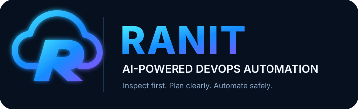

<div align="center">



### AI-Powered DevOps Automation CLI

**You choose the project. RANIT helps automate the workflow.**


RANIT is an early-stage command-line DevOps assistant for inspecting a local project, detecting common technology markers, and progressively adding safer build, test, infrastructure, and deployment workflows.

</div>

---

## ✨ Vision

- 🔎 Analyze a project folder you provide.
- 🩺 Check the local DevOps toolchain.
- 🧪 Add controlled build and test workflows.
- 📦 Support Docker and container workflows.
- 🏗️ Prepare Terraform and AWS workflows.
- ☸️ Support Kubernetes operations.
- 🚀 Add deployment health checks and guarded rollback.
- 🤖 Integrate an optional AI provider.

> **Current status:** CLI, environment diagnostics, and read-only project analysis are implemented. Autonomous AI fixes, dependency installation, AWS provisioning, Kubernetes deployment, and rollback are roadmap items—not current capabilities.

## 🚀 Quick start

### Requirements
- Python 3.10+
- Windows PowerShell, Linux shell, or macOS Terminal
- Git recommended; Docker, Terraform, AWS CLI, and kubectl are optional at this stage

### 1. Clone the repository

```powershell
git clone https://github.com/nitindrathod4-alt/ranit-devops-automation.git
cd ranit-devops-automation
```

### 2. Create and activate a virtual environment

**Windows PowerShell**
```powershell
py -m venv .venv
.\.venv\Scripts\Activate.ps1
```

If activation is blocked, run the environment's Python directly:
```powershell
.\.venv\Scripts\python.exe -m pip install -e ".[dev]"
```

**Linux/macOS**
```bash
python3 -m venv .venv
source .venv/bin/activate
```

### 3. Install RANIT for development

```bash
python -m pip install --upgrade pip
python -m pip install -e ".[dev]"
```

### 4. Run commands

```bash
ranit --version
ranit doctor
ranit init
ranit analyze "./my-project"
ranit analyze "./my-project" --json
ranit scan "./my-project"
ranit scan "./my-project" --json
ranit diagnose "./error.log"
ranit diagnose "./error.log" --json
```

## 🧰 Command reference

| Command | Purpose | Status |
|---|---|---|
| `ranit --version` | Show installed version | Available |
| `ranit --help` | Show help | Available |
| `ranit doctor` | Check installed tool availability | Available |
| `ranit init` | Show setup and safety checklist | Available |
| `ranit analyze <path>` | Read-only project marker scan | Available |
| `ranit analyze <path> --json` | Emit JSON report | Available |
| `ranit fix` | AI-assisted repairs | Planned |
| `ranit test` | Project-aware test orchestration | Planned |
| `ranit deploy` | Deployment workflows | Planned; disabled |
| `ranit aws ...` | AWS automation | Planned; disabled |

## 🩺 Local log diagnosis (basic)\n\nUse `ranit diagnose ./error.log` to match a local text log against a small set of common Python, Docker/Kubernetes, AWS access, network, disk/memory, and permission error patterns. RANIT prints suggested checks, not the log contents. Logs larger than 2 MB are rejected. The command is local and read-only; it does not call an AI provider, execute commands, fix files, or guarantee a root cause. Treat results as suggestions and inspect the original logs securely.\n\n## 🔍 Project markers detected

The current analyzer detects common files associated with:
- Python: `pyproject.toml`, `requirements.txt`, `Pipfile`
- JavaScript/Node.js: `package.json`
- Java/JVM: `pom.xml`, `build.gradle`, `build.gradle.kts`
- Go: `go.mod`
- Rust: `Cargo.toml`
- Ruby: `Gemfile`
- PHP: `composer.json`
- Containers: `Dockerfile`, Docker Compose files
- Delivery/infrastructure: `Jenkinsfile`, `.gitlab-ci.yml`, `azure-pipelines.yml`, `Chart.yaml`

It skips common generated directories such as `.git`, virtual environments, `node_modules`, and `.terraform`. It does not execute scripts, install dependencies, modify files, or provision cloud resources.

## 🔐 Security-first by design

Before RANIT executes project commands or changes cloud infrastructure, it should have:
1. Explicit project and environment selection.
2. Dry-run plans before changes.
3. Least-privilege cloud access and short-lived credentials where possible.
4. Secret protection: never commit keys, tokens, private keys, or `.env` files.
5. Cloud cost warnings and limits where possible; a budget alert is not always a hard spending cap.
6. Approval gates for destructive and production actions.
7. Isolation for untrusted code; never run unknown scripts as Administrator/root.
8. Audit logs for proposed and executed actions.

**Never put AWS access keys in source code, README files, prompts, or GitHub.** Prefer appropriately scoped IAM roles or AWS CLI profiles. AWS resources may incur charges.

## 🧪 Tests

```bash
python -m pip install -e ".[dev]"
pytest
```

GitHub Actions runs tests for pushes and pull requests targeting `main`.

## 🗺️ Roadmap

- [x] Python package and CLI entry point
- [x] Environment diagnostics
- [x] Read-only project marker detection
- [x] JSON report\n- [x] Basic local pattern-based log diagnosis
- [x] Unit tests and GitHub Actions workflow
- [ ] Safe command execution framework with allowlists, timeouts, and dry-run mode
- [ ] Build/test adapters by project type
- [ ] Optional local AI provider integration
- [ ] Docker and Compose analysis
- [ ] Terraform plan inspection and approval workflow
- [ ] AWS account/region preflight and least-privilege checks
- [ ] Kubernetes context and namespace preflight
- [ ] Deployment health checks and guarded rollback
- [ ] Signed releases and optional PyPI distribution

## 🤝 Contributing

Use issues and pull requests. Never include credentials, tokens, private keys, or real customer secrets in issues or tests.

## 📜 License

MIT — see [LICENSE](LICENSE).

<div align="center">

**RANIT — Inspect first. Plan clearly. Automate safely.**

</div>


## Security scan (alpha)

Run a read-only heuristic scan on a local project you own or are authorized to inspect:

```bash
ranit scan ./my-project
ranit scan ./my-project --json
```

The scanner reports possible hard-coded credentials, risky patterns, dependency manifests, and deployment files. It does not execute project code or change files. Results are heuristic and can include false positives or miss issues; this is not a substitute for a dedicated security scanner.


## 🩺 Project health check

Run a read-only check against a local project directory:

```bash
ranit health ./my-project
ranit health ./my-project --json
```

The health check reports recognized project markers and checks whether related local tools (such as Python, Node.js, Java, Go, Rust, Docker, or Git) are available on PATH. A missing tool is a warning, not proof that the project is broken. An unrecognized project directory is reported as an error. This command does not run builds or tests, install dependencies, execute project scripts, modify files, or provision cloud resources.

